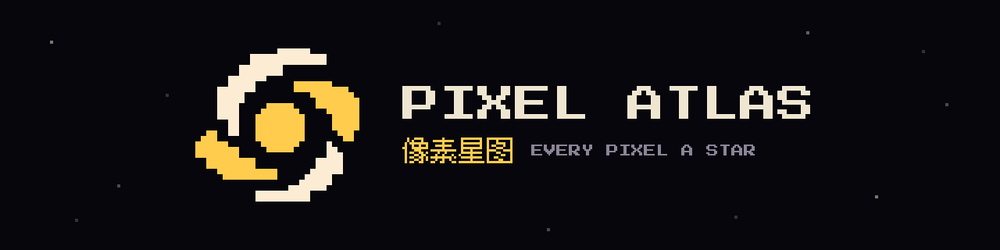
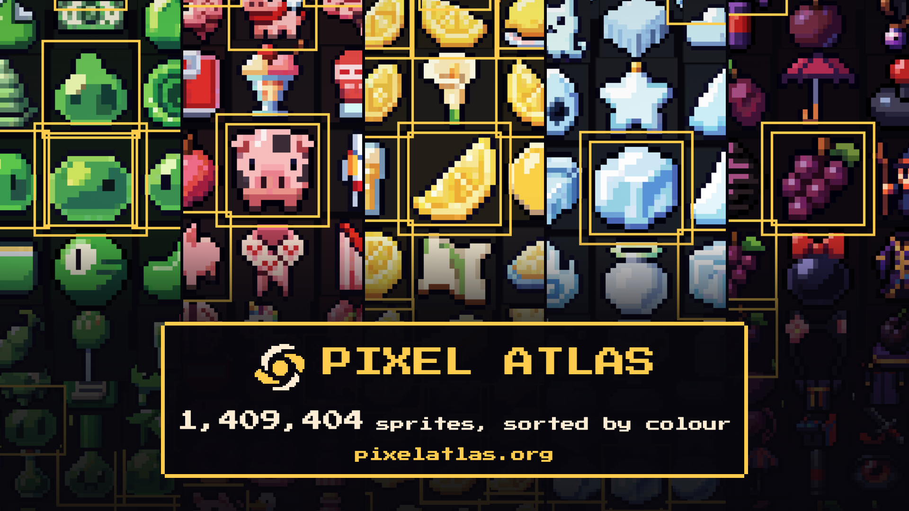
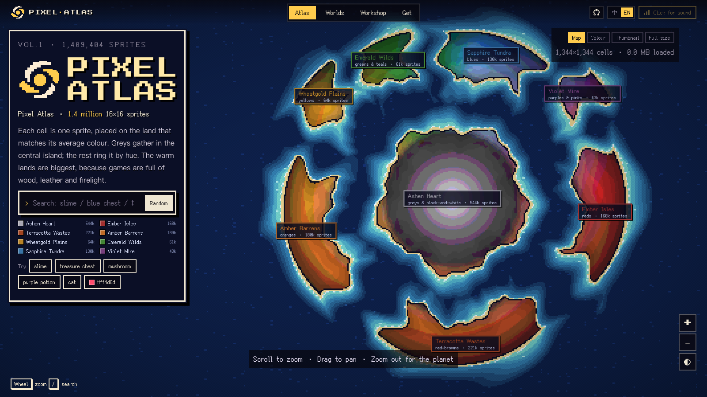
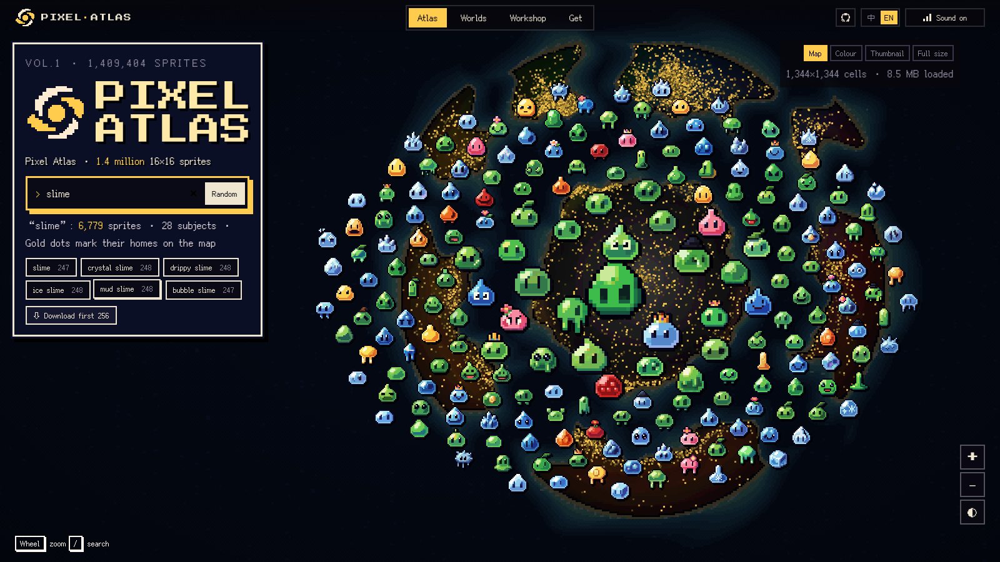
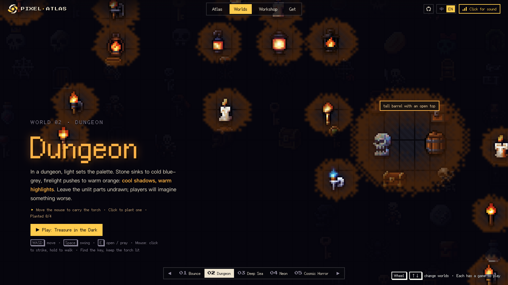
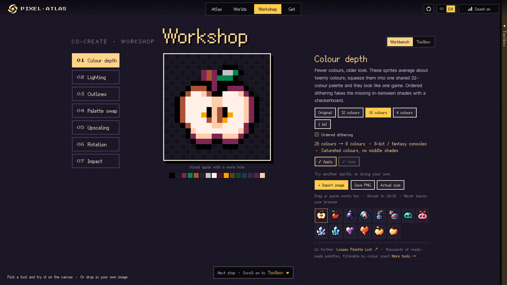
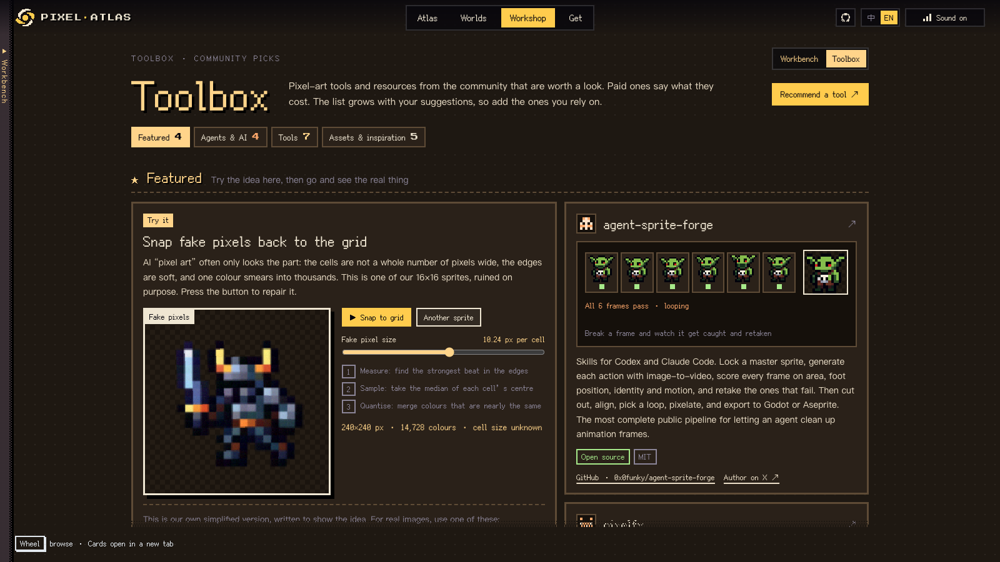

<p align="center">
  
</p>

# Pixel Atlas · 像素星图

English · [简体中文](README.zh-CN.md)

<p>
  <a href="https://pixelatlas.org"></a>
  <a href="https://pixelatlas.org/en/"></a>
  <a href="https://pixelatlas.org/en/"></a>
  <a href="https://pixelatlas.org/en/#toolbox"></a>
  <a href="https://github.com/polang233/pixel-atlas/stargazers"></a>
  <a href="https://github.com/polang233/pixel-atlas/commits/main"></a>
  <a href="https://huggingface.co/datasets/Angais/pixel-art-atlas-1.4m"></a>
  <a href="https://x.com/polang233"></a>
</p>

**Millions of pixel-art resources, in one place.**

It starts with every 16×16 sprite of [Angais/pixel-art-atlas-1.4m](https://huggingface.co/datasets/Angais/pixel-art-atlas-1.4m) laid out on one zoomable map and sorted by colour, so you can fly from orbit down to a single sprite. Around it are themed worlds with small playable retro games and short pieces on pixel art: colour depth, palettes, squash and stretch. A workshop lets you try pixel-art techniques on any sprite, and a toolbox collects the community's best pixel tools.

<a href="https://x.com/polang233/status/2121321754799038615"></a>
<p align="center"><a href="https://x.com/polang233/status/2121321754799038615">▶ Watch the 43-second trailer on X</a></p>

Live at <https://pixelatlas.org> (Chinese) and <https://pixelatlas.org/en/> (English). Still a work in progress.

> Pixel Atlas is an independent project. It is not made by, or affiliated with, the author of the original dataset.

## By the numbers

| | |
|---:|---|
| **1,409,404** | 16×16 sprites, every one of them on a single 1,344 × 1,344 map |
| **8** | lands, one per colour family; zoom out and they close up into a planet |
| **6,194** | subjects to search, in English or Chinese, plus any colour by name or hex |
| **5** | worlds, each with a retro game you can play in the browser |
| **7** | workshop tools, run on your own images without uploading them |
| **20** | community tools and resources in the toolbox, with live demos of the ideas behind them |
| **256** | sprites per batch download, as one sprite sheet with a manifest |

## What is in it

### The map

All 1,409,404 sprites on one zoomable world, split into eight lands by average colour. Zoom out and the lands close up into a planet; zoom in and the atlas streams in tile by tile.



### Search

Type a subject or a colour, in English or Chinese (`slime`, `blue chest`, `#ff4d6d`). The matches gather in front of you, gold dots mark where they live on the map, and any of them can fly you there. Up to 256 at a time download as a sprite sheet.



### Worlds

Themed chapters, each a short piece on pixel-art craft with a small game to play: Bounce, Dungeon, Deep Sea, Neon and Cosmic Horror.



### Workshop

Try colour depth, lighting, outlines, palette swaps, upscaling (Scale2x), rotation (RotSprite) and hit effects on any sprite, or on an image of your own. Stack the effects, undo them, and save the result as a PNG. Nothing leaves your browser.



### Toolbox

The workshop's second sheet: pixel-art tools from the community worth knowing about, in three groups (agents and AI workflows, tools, assets and inspiration). The featured ones come with a small working demo of their idea, such as snapping fake AI "pixel art" back onto a real grid. Paid tools say what they cost. Know a good one? [Recommend it](https://github.com/polang233/pixel-atlas/issues/new?template=tool-suggestion.yml).



## Get the sprites

| How many | How |
|---|---|
| One | Open a sprite on the map and save it at 16×16, or enlarged 16 times. |
| A batch | Search, then press **Download batch**: up to 256 sprites in one sprite sheet, with a `manifest.json` listing each sprite's dataset index, subject and caption. |
| All of them | Straight from [the dataset on Hugging Face](https://huggingface.co/datasets/Angais/pixel-art-atlas-1.4m): Parquet shards (about 430 MB) or one 259 MB ZIP. |

```python
from datasets import load_dataset
sprites = load_dataset("Angais/pixel-art-atlas-1.4m", split="train")
```

The *dataset index* shown on the site is the sprite's row in the dataset ZIP (`tokens.npy`, `captions.json`, `objects.json`).

Coming next: our additions (the colour layout, search index and Chinese subject names) as a dataset of their own on Hugging Face, a command-line tool and a dsh skill.

## Run it locally

```bash
npm install
npm run dev
```

The streaming atlas under `public/atlas/` (about 340 MB) is not in the repo. Generate it with `pipeline/build_atlas.py`, which reads the Hugging Face dataset; its Python dependencies are in `pipeline/requirements.txt`.

Before sending a change, run `npm run ci`: it checks formatting and lint with [Biome](https://biomejs.dev), type-checks and builds.

## Licences

| What | Licence |
|---|---|
| Code in this repo (site and pipeline) | [MPL-2.0](LICENSE) |
| Data we add on top of the dataset: layout, colour index, translations, sprite sheets | CC BY 4.0 |
| The sprites themselves | CC0, as released by the dataset author, to the extent of the rights they can waive |

The sprites were generated with Krea 2. CC0 does not override the Krea 2 Community License or the Krea Acceptable Use Policy. Some sprites may resemble existing characters or trademarks, so check before using them commercially.

## Credits

- Sprites: [Angais/pixel-art-atlas-1.4m](https://huggingface.co/datasets/Angais/pixel-art-atlas-1.4m)
- Pixel fonts: Fusion Pixel (OFL-1.1, see `public/fonts/OFL-fusion-pixel.txt`), Press Start 2P (OFL-1.1, via Fontsource)

## Citing

If Pixel Atlas helps your work, please cite it. GitHub's "Cite this repository" button reads [`CITATION.cff`](CITATION.cff); the same in BibTeX:

```bibtex
@misc{pixelatlas2026,
  title        = {Pixel Atlas: millions of pixel-art resources, in one place},
  author       = {polang233},
  year         = {2026},
  howpublished = {\url{https://pixelatlas.org}},
  note         = {Source code: \url{https://github.com/polang233/pixel-atlas}}
}
```

Please also credit the sprites' source, [Angais/pixel-art-atlas-1.4m](https://huggingface.co/datasets/Angais/pixel-art-atlas-1.4m).

## Feedback

Bugs and ideas are welcome in [issues](https://github.com/polang233/pixel-atlas/issues). Updates are posted on X: [@polang233](https://x.com/polang233).
