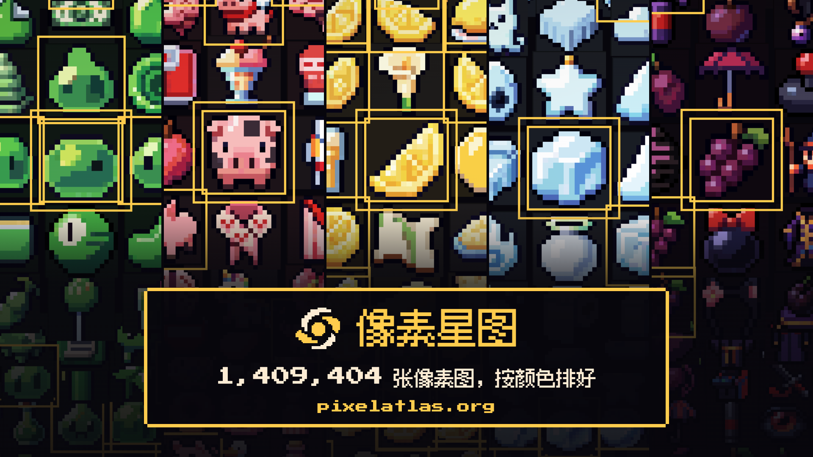
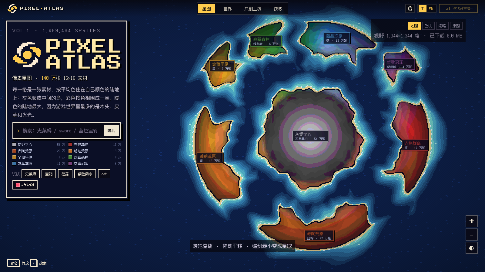
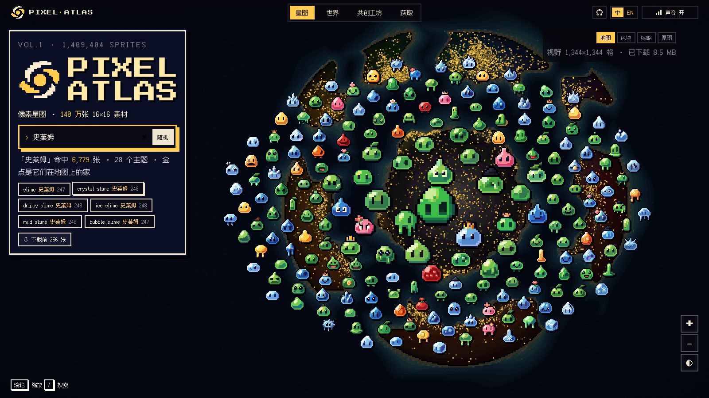
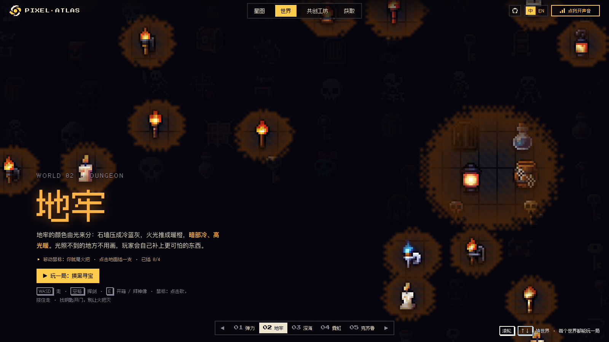
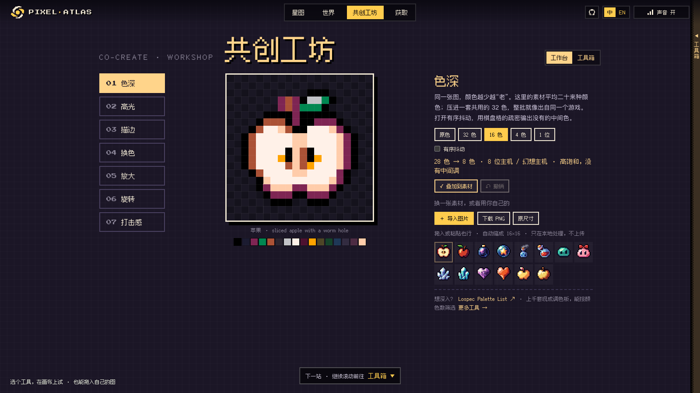
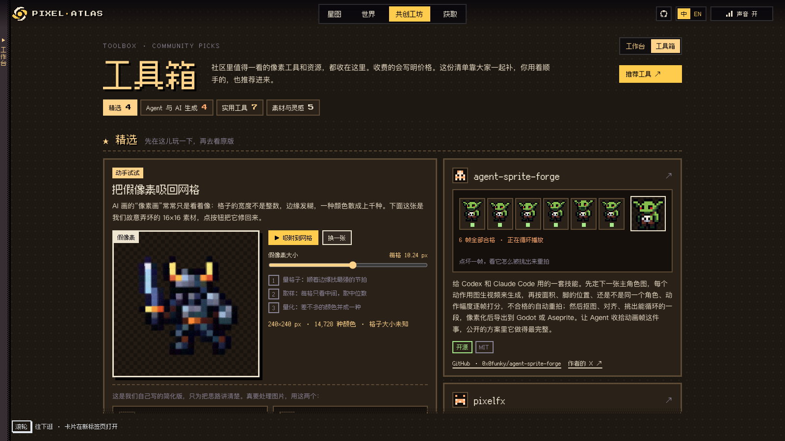

<p align="center">
  
</p>

# 像素星图 · Pixel Atlas

[English](README.md) · 简体中文

<p>
  <a href="https://pixelatlas.org"></a>
  <a href="https://pixelatlas.org"></a>
  <a href="https://pixelatlas.org"></a>
  <a href="https://pixelatlas.org/#toolbox"></a>
  <a href="https://github.com/polang233/pixel-atlas/stargazers"></a>
  <a href="https://github.com/polang233/pixel-atlas/commits/main"></a>
  <a href="https://huggingface.co/datasets/Angais/pixel-art-atlas-1.4m"></a>
  <a href="https://x.com/polang233"></a>
</p>

**像素资源合集，越攒越多。**

第一批是 [Angais/pixel-art-atlas-1.4m](https://huggingface.co/datasets/Angais/pixel-art-atlas-1.4m) 里的全部 16×16 素材：按颜色排成一张可以缩放的地图，从星球一路放大到单张素材。地图周围是几个主题小世界，每个都有能玩的复古小游戏，也顺便讲讲像素画的手艺：色深、调色板、挤压拉伸。共创工坊里可以拿任意素材试各种像素画技法，工具箱则收着社区里好用的像素工具。

<a href="https://x.com/polang233/status/2122038363654103146"></a>
<p align="center"><a href="https://x.com/polang233/status/2122038363654103146">▶ 在 X 上看 43 秒宣传片</a></p>

网站：中文版 <https://pixelatlas.org>，英文版 <https://pixelatlas.org/en/>。还在持续更新。

> 像素星图是独立项目，与原数据集作者无关，也不是官方出品。

## 一些数字

| | |
|---:|---|
| **1,409,404** | 张 16×16 素材，全部铺在同一张 1,344 × 1,344 的地图上 |
| **8** | 块陆地，按色系划分；一直缩小，会合拢成一颗星球 |
| **6,194** | 个主题可以搜，中英文都行，也能按颜色名或色值搜 |
| **5** | 个主题世界，每个都有一款能直接在浏览器里玩的复古小游戏 |
| **7** | 种工坊工具，自己的图片也能用，不用上传 |
| **20** | 个社区工具和资源收在工具箱里，精选的还配了可以上手试的小演示 |
| **256** | 张一批打包下载，拼成一张精灵表，附清单 |

## 有什么

### 星图

140 万张素材铺在一张地图上，按平均色分成八块陆地。一直缩小，陆地会合拢成一颗星球；放大时图块一块块加载进来。



### 搜索

中英文都能搜，主题或颜色都行（`史莱姆`、`蓝色宝箱`、`#ff4d6d`）。结果会聚到眼前，金色小点标出它们在地图上的家，点一下就能飞过去。一次最多打包下载 256 张。



### 世界

几个主题章节，每个讲一点像素画手艺，再配一款小游戏：弹力、地牢、深海、霓虹、克苏鲁。



### 共创工坊

拿任意一张素材，或者你自己的图片，试试色深、高光、描边、换色、放大（Scale2x）、旋转（RotSprite）和打击感。效果可以叠加、撤销，最后存成 PNG。全程只在你的浏览器里处理。



### 工具箱

共创工坊的第二层，收着社区里值得一看的像素工具和资源，分成 Agent 与 AI 生成、实用工具、素材与灵感三类。精选的几个配了能上手试的小演示，比如把 AI 画的「假像素」吸回真正的网格。收费的都写明了价格。有好用的工具，欢迎[推荐进来](https://github.com/polang233/pixel-atlas/issues/new?template=tool-suggestion.yml)。



## 获取素材

| 要多少 | 怎么拿 |
|---|---|
| 一张 | 在星图里点开素材，下载 16×16 原图，或放大 16 倍的版本。 |
| 一批 | 搜索之后点「下载这一批」：最多 256 张拼成一张精灵表，附一份 `manifest.json`，写着每张的数据集序号、主题和描述。 |
| 全部 | 直接去 [Hugging Face 上的原数据集](https://huggingface.co/datasets/Angais/pixel-art-atlas-1.4m)：Parquet 分片约 430 MB，或一个 259 MB 的 ZIP。 |

```python
from datasets import load_dataset
sprites = load_dataset("Angais/pixel-art-atlas-1.4m", split="train")
```

网站上显示的「数据集序号」，就是这张素材在原数据集 ZIP 里的行号（对应 `tokens.npy`、`captions.json`、`objects.json`）。

在路上：我们加的数据（色彩排列、搜索索引、中文译名）会单独发成一个 Hugging Face 数据集；命令行工具和 dsh 技能也在做。

## 本地运行

```bash
npm install
npm run dev
```

`public/atlas/` 下的流式图集（约 340 MB）不在仓库里，用 `pipeline/build_atlas.py` 从 Hugging Face 数据集生成，Python 依赖见 `pipeline/requirements.txt`。

提交改动前请跑一遍 `npm run ci`：用 [Biome](https://biomejs.dev) 检查格式和代码，再做类型检查和构建。

## 许可

| 内容 | 许可 |
|---|---|
| 本仓库的代码（网站和数据管线） | [MPL-2.0](LICENSE) |
| 我们在数据集之上加的数据：排列、色彩索引、翻译、精灵表 | CC BY 4.0 |
| 素材本身 | CC0，由原数据集作者发布，以其能放弃的权利为限 |

素材由 Krea 2 生成。CC0 不能替代 Krea 2 社区许可和 Krea 使用政策。个别素材可能接近已有角色或商标，商用前请自查。

## 致谢

- 素材：[Angais/pixel-art-atlas-1.4m](https://huggingface.co/datasets/Angais/pixel-art-atlas-1.4m)
- 像素字体：Fusion Pixel（OFL-1.1，见 `public/fonts/OFL-fusion-pixel.txt`）、Press Start 2P（OFL-1.1，经 Fontsource）

## 引用

如果像素星图对你的工作有帮助，欢迎引用。GitHub 仓库页的「Cite this repository」按钮读取 [`CITATION.cff`](CITATION.cff)，BibTeX 见[英文 README](README.md#citing)。也请一并注明素材来源 [Angais/pixel-art-atlas-1.4m](https://huggingface.co/datasets/Angais/pixel-art-atlas-1.4m)。

## 反馈

问题和想法欢迎提到 [Issues](https://github.com/polang233/pixel-atlas/issues)，更新会发在 X：[@polang233](https://x.com/polang233)。
