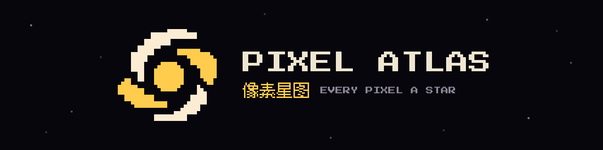

<p align="center">
  
</p>

# 像素星图 · Pixel Atlas

[English](README.md) · 简体中文

<p>
  <a href="https://pixelatlas.org"></a>
  <a href="LICENSE"></a>
  <a href="#许可"></a>
  <a href="https://huggingface.co/datasets/Angais/pixel-art-atlas-1.4m"></a>
  <a href="https://x.com/polang233"></a>
</p>

**像素资源合集，越攒越多。**

第一批是 [Angais/pixel-art-atlas-1.4m](https://huggingface.co/datasets/Angais/pixel-art-atlas-1.4m) 里的全部 16×16 素材：按颜色排成一张可以缩放的地图，从星球一路放大到单张素材。地图周围是几个主题小世界，每个都有能玩的复古小游戏，也顺便讲讲像素画的手艺：色深、调色板、挤压拉伸。

网站：中文版 <https://pixelatlas.org>，英文版 <https://pixelatlas.org/en/>。还在持续更新。

> 像素星图是独立项目，与原数据集作者无关，也不是官方出品。

## 有什么

- **星图**：1,409,404 张素材铺在一张地图上，按平均色分成八块陆地；一直缩小，陆地会合拢成一颗星球。
- **搜索**：中英文都能搜，主题或颜色都行（`史莱姆`、`蓝色宝箱`、`#ff4d6d`）。结果会聚到眼前，点一下就飞回它在地图上的位置。
- **世界**：几个主题章节，各带一个小游戏和一段像素画小知识。
- **共创工坊**：拿任意一张素材，或者你自己的图片，试试色深、高光、描边、换色、放大、旋转和打击感。

## 获取素材

| 要多少 | 怎么拿 |
|---|---|
| 一张 | 在星图里点开素材，下载 16×16 原图，或放大 16 倍的版本。 |
| 一批 | 搜索之后点「下载这一批」：最多 256 张拼成一张精灵表，附一份 `manifest.json`，写着每张的数据集序号、主题和描述。 |
| 全部 | 直接去 [Hugging Face 上的原数据集](https://huggingface.co/datasets/Angais/pixel-art-atlas-1.4m)：Parquet 分片约 430 MB，或一个 259 MB 的 ZIP。 |

```python
from datasets import load_dataset
sprites = load_dataset("Angais/pixel-art-atlas-1.4m", split="train")
```

网站上显示的「数据集序号」，就是这张素材在原数据集 ZIP 里的行号（对应 `tokens.npy`、`captions.json`、`objects.json`）。

在路上：我们加的数据（色彩排列、搜索索引、中文译名）会单独发成一个 Hugging Face 数据集；命令行工具和 dsh 技能也在做。

## 本地运行

```bash
npm install
npm run dev
```

`public/atlas/` 下的流式图集（约 340 MB）不在仓库里，用 `pipeline/build_atlas.py` 从 Hugging Face 数据集生成，Python 依赖见 `pipeline/requirements.txt`。

提交改动前请跑一遍 `npm run ci`：用 [Biome](https://biomejs.dev) 检查格式和代码，再做类型检查和构建。

## 许可

| 内容 | 许可 |
|---|---|
| 本仓库的代码（网站和数据管线） | [MPL-2.0](LICENSE) |
| 我们在数据集之上加的数据：排列、色彩索引、翻译、精灵表 | CC BY 4.0 |
| 素材本身 | CC0，由原数据集作者发布，以其能放弃的权利为限 |

素材由 Krea 2 生成。CC0 不能替代 Krea 2 社区许可和 Krea 使用政策。个别素材可能接近已有角色或商标，商用前请自查。

## 致谢

- 素材：[Angais/pixel-art-atlas-1.4m](https://huggingface.co/datasets/Angais/pixel-art-atlas-1.4m)
- 像素字体：Fusion Pixel（OFL-1.1，见 `public/fonts/OFL-fusion-pixel.txt`）、Press Start 2P（OFL-1.1，经 Fontsource）

## 引用

如果像素星图对你的工作有帮助，欢迎引用。GitHub 仓库页的「Cite this repository」按钮读取 [`CITATION.cff`](CITATION.cff)，BibTeX 见[英文 README](README.md#citing)。也请一并注明素材来源 [Angais/pixel-art-atlas-1.4m](https://huggingface.co/datasets/Angais/pixel-art-atlas-1.4m)。

## 反馈

问题和想法欢迎提到 [Issues](https://github.com/polang233/pixel-atlas/issues)，更新会发在 X：[@polang233](https://x.com/polang233)。
